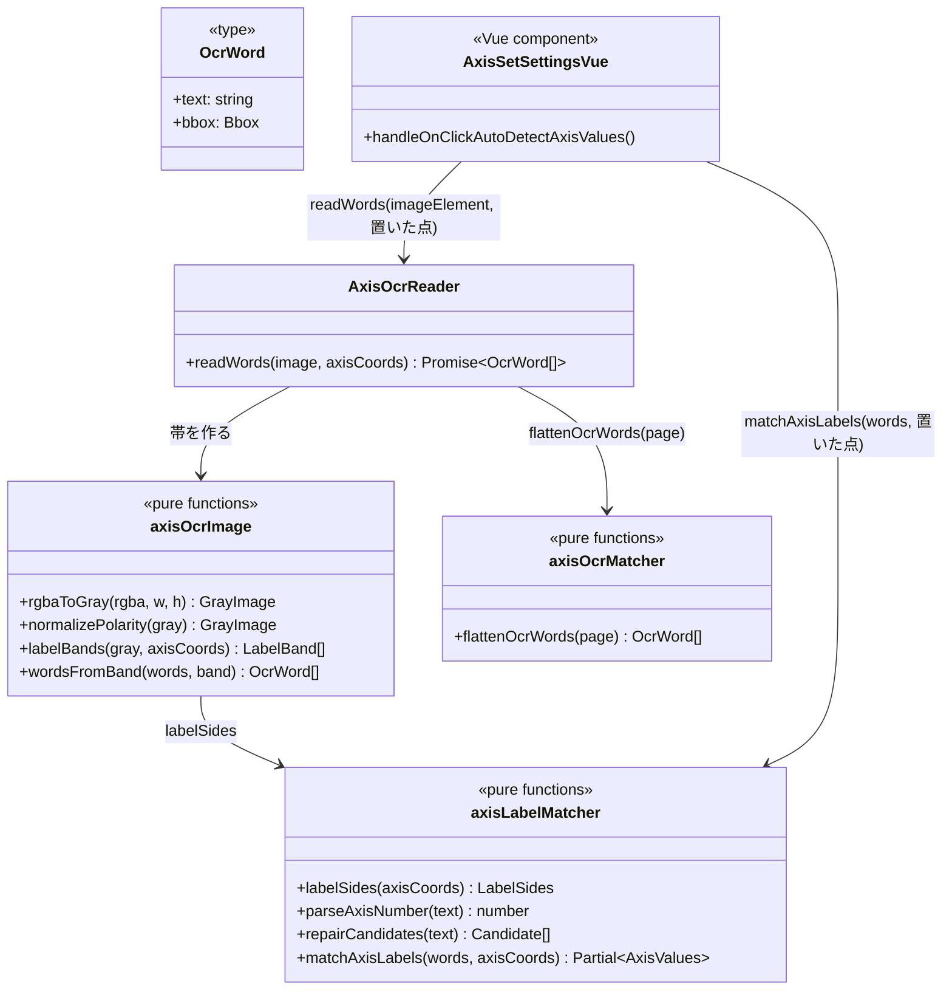

# 実装設計: 軸ラベルOCR自動検出

HQ #42。スコープはHQ指示どおり最小に絞る: フル自動軸検出(軸線位置そのものの検出)ではなく、
**ユーザーが従来どおりキャンバス上でx1/x2/y1/y2の軸座標(ピクセル位置)をクリック指定した後、
その近傍にある数値ラベルをtesseract.jsでOCRして軸値入力欄に自動セットする**機能。

2026-11-23 に読み方を改めた（下の「2026-11-23 の改良」）。すべてブラウザの中で動く。サーバーには何も送らない。

## 方針

- 誤検出時の専用フォールバックUIは作らない。OCR結果は既存の軸値入力欄(`AxisSetSettings.vue`)にそのままセットするだけで、
  違っていればユーザーが今までどおり手入力で上書きすればよい(既存UIが既にフォールバックとして機能する)。
- **誤った値を入れるより、空のまま残す。** ラベルどうしが食い違うときは入れない（2026-11-23 から）。
- 1回のボタン押下で tesseract の worker を1つ作り、図全体と、軸の横の帯を読む。結果を4軸に配り分ける。

## 2026-11-23 の改良

### 前の方式と、その誤り

- 前の方式: 置いた点から 150 px 以内で、一番近い数値の単語を採る。
- real-chart-bench の 91 図で測ると、両軸とも合うのは **23 図**。値の 364 個のうち、誤りが多かった。
  - 小数点やマイナスが落ちる: 34（"1.4"→14、"-40"→40）
  - もう一方の軸のラベルを拾う: 36（原点の近く。x1 が y 軸の "0" を採る）
  - そのほかの誤り: 41
  - 空: 14

### 新しい方式

画素の処理（`src/application/utils/axisOcrImage.ts`、純粋な関数）

- 置いた点から、ラベルがある帯を決める。
  - x 軸の線（x1・x2 の行）の下。y 軸の線（y1・y2 の列）の左。
  - y 軸の線が x の点の真ん中より右なら、右側の軸とみなし、帯を右に取る。x 軸の線が y の点の真ん中より上なら、上の軸とみなす。
  - 帯の幅は図の 20%。線の反対側にも 3% はみ出す（線に触れたラベルを切らないため）。
- 図を灰色にする。白黒が逆の図（黒地に白い字）は反転する。図の画素の中央値が暗ければ黒地とみなす。
- 帯を拡大する。図の長い辺が約 2000 px になる倍率で、1〜3 倍。双一次補間。周りに 10 px の白い余白を足す。

OCR（`src/application/services/axisOcr/axisOcrReader.ts`）

- 1 つの worker で次を読む。
  1. 図全体。今までと同じ設定（tesseract.js の既定。1 つのブロックとして読む）。
  2. 帯ごとに 1 回。PSM 11（sparse text。行を仮定せず、散らばった文字を探す）。
- 帯の単語の座標は、図の画素に戻す。
- canvas が読めないとき（cross-origin で汚れた画像など）は、1 だけにする。
- tesseract.js、画素の関数、選ぶ関数は、ボタンを押したときに動的に読み込む。最初のバンドルには入らない（`vite build` で別の chunk になるのを確かめた。2 つで gzip 約 3.5 kB）。

値の選び方（`src/application/utils/axisLabelMatcher.ts`、純粋な関数）

1. 軸ごとに、ラベルの側にある数値の単語だけを残す。
   - x 軸なら線の下（上の軸なら上）。y 軸なら線の左（右の軸なら右）。
   - 線からの距離は、ラベルの高さの 6 倍まで。
   - もう一方の軸のラベル（原点の "0" など）は除く。y のラベルは y 軸の線より完全に左にあり、x のラベルは x 軸の線より完全に下にある。
   - 数として読む: 「−」（U+2212）やダッシュはマイナス。"0,1" は 0.1、"1,000" は 1000。
2. 同じ場所の単語（図全体と帯で 2 回読まれたもの）を 1 つのラベルにまとめる。読みの違い（"-40" と "40"）は候補として両方残す。
3. 読みごとに、直しの候補を作る。カッコ内はコスト。
   - そのまま（0）
   - 小数点を足す（"14"→1.4）、マイナスを足す（0.25）
   - 読んだマイナスを外す（1）。余分なマイナスは、落ちたマイナスよりまれと考えた（推測）。
   - "08" のように 0 で始まる整数は、そのままでは採らない。軸に "08" とは書かない。
   - 別の読みに小数点やマイナスがあれば、それの無い読みは（1）。
4. 軸の目盛ラベルは「始まりの値 + 刻みの整数倍」に並ぶ。これを使って、ラベルの並ぶ直線（値と画素の位置の関係）を探す。
   - すべてのラベルの組と、その候補の組で直線を引き、点数の一番高いものを採る。
   - ラベルが直線に乗るのは、予想の位置からラベルの間隔の 1/6（3 px 以上）以内のとき。
   - 点数: 乗ったラベルごとに 1 − コスト。さらに、
     - 小数の桁が他のラベルより少ない読みは −0.5（"0.0" と並ぶ "40" は 4.0 らしい）。
     - 刻みの格子から 3% より外れる値は乗せない（"12" が "121" と読まれ 12.1 に直されたもの）。
     - 直線の目盛の位置にあり、直しなしで読めて、別の値を言うラベルは 1 つにつき −1（偶然そろった 3 つの誤読を退ける）。
     - 値の向きが逆（x が左へ増える、y が下へ増える）なら −0.1。両方に合うとき（"60 40 20 0 20 40 60"）だけ効く。
   - log 軸: log10 で直線を引く。1・2・3・5 × 10^n の値だけを使い、10^n が 2 つ以上いる。
   - 乗るラベルが 3 つ未満なら、その軸は空にする。2 つでは何も確かめられない。
   - "10" が 2 か所以上で読めた軸は空にする。上付きの指数（10²）が落ちた log 軸とみなす。
5. 点ごとに値を決める。
   - 点の位置に重なるラベル（軸の方向に、ラベルの箱 + 高さの半分以内）が直線に乗っていれば、その値。
   - そうでなければ、点が直線の目盛の上（刻みの 1/10 以内、外側のラベルから 1 刻みまで）にあるとき、その目盛の値。線形の軸だけ。
   - どちらでもなければ空。

画面（`AxisSetSettings.vue`）

- 読む関数にも選ぶ関数にも、置いたすべての点を渡す。もう一方の軸の点は、ラベルの側と、もう一方の軸のラベルを見分けるのに使う。auto service が値を出した点は、そちらを使う（今までどおり）。
- 常に出しているヒントの文を改めた。「ラベルどうしが合うところだけ埋めるので、空の欄が残ることがある。読み違いもありうるので確かめて」。小数点の落ちる例は消した。

### 測った結果（2026-11-23）

やり方

- real-chart-bench の `data/verified_pairs`、画像のある **91 図**。人の 2 目盛を各軸に使う。
- 物差し: 自動の値と図に書かれた値の差が、目盛の幅（log 軸は桁）の 0.5% 以内なら、その軸は合格。図は両軸とも合格で合格。
- 「値の誤り」は、入った値（1 つずつ）のうち 0.5% を超えて外れたもの。
- 「空の軸」は、その軸の 2 つの点のどちらかが空のもの。
- クリックは 2 通りで作った。
  - **元のクリック**: `~/research/drafts/axis-autofill-eval/clicks.py` と同じ。軸の線を、目盛の間で暗い画素が一番多い行・列で推す。y 軸は図の左 60% から探す。前の 23 図はこれで測った。
  - **人に近いクリック**: 上と同じ。ただし、右側の y 軸（10 図）と黒地の図（2 図）では、人がクリックする線に直した。元のクリックでは、この 12 図の点が軸の線に乗っていない（目で確かめた: 10939 fig4b、44283 fig3b、32593 fig1a）。
- OCR は tesseract.js 6、データ best_int（ブラウザの既定と同じ）。画素の関数と選ぶ関数は、リポジトリのコードそのもの。
- 0〜6 の段は Node で、OCR の結果を保存し、選ぶ関数だけ変えて測った。Node では canvas の代わりに PIL で画像をほどき、帯は PGM で渡した。
- 「最終」は、ヘッドレスの Chromium で `AxisOcrReader` と `matchAxisLabels` そのもの（canvas から帯を作る道）を動かした。図ごとに worker を作る。アプリと同じ形。Node で同じ形にしても、数は同じだった。

| 段                               | 元のクリック: 合格図 | 値の誤り／入った値 | 誤った軸 | 空の軸 | 人に近いクリック: 合格図 | 値の誤り／入った値 | 空の軸 |
| -------------------------------- | -------------------- | ------------------ | -------- | ------ | ------------------------ | ------------------ | ------ |
| 0 前の方式                       | 23                   | 111／350           | 79       | 13     | 25                       | 112／357           | 7      |
| 1 ラベルの側と並びだけ           | 33                   | 35／287            | 24       | 55     | 38                       | 35／305            | 46     |
| 2 + 直線（読んだまま）           | 26                   | 7／229             | 1        | 86     | 30                       | 7／244             | 78     |
| 3 + 直し・小数の桁・食い違い     | 41                   | 2／266             | 1        | 61     | 46                       | 2／284             | 52     |
| 4 + 目盛の上の点を直線で埋める   | 56                   | 2／290             | 1        | 39     | 63                       | 2／309             | 29     |
| 5 + 拡大した帯の OCR             | 68                   | 0／314             | 0        | 26     | 77                       | 0／336             | 14     |
| 参考: 帯だけ（図全体を読まない） | 52                   | 1／277             | 0        | 47     | 59                       | 1／295             | 37     |
| 参考: 前の選び方 + 帯の OCR      | 27                   | 97／351            | 71       | 12     | 28                       | 99／360            | 4      |
| **最終（ブラウザ）**             | **69**               | **0／316**         | **0**    | **25** | **78**                   | **0／338**         | **13** |

時間（1 図。ブラウザは worker の起動を含む。Node は含まない）

|                                  | 前の方式         | 最終             |
| -------------------------------- | ---------------- | ---------------- |
| ヘッドレス Chromium 中央値／最大 | 0.52 秒／0.88 秒 | 0.70 秒／1.26 秒 |
| Node 中央値／最大                | 0.27 秒／0.60 秒 | 0.46 秒／0.95 秒 |

- 計った機械はこの VM（Lima、arm64）。人の Mac のブラウザでは違う（未確認）。
- 帯の拡大率は 1・2・3 倍と「長い辺 2000 px まで」を比べた。2 倍と 3 倍はほぼ同じ。採ったのは「2000 px まで、3 倍以下」（大きな図で時間を抑えるため）。
- 増えなかったもの: 帯を PSM 6 で読む、数字だけに絞る（whitelist）、Otsu で 2 値にする、帯の読みを 2 通りにする。合格図が増えないか、誤りが増えた。
- 乗るラベルを 2 つで良しとすると、元のクリックで +1 図（誤りは増えない）。2 つでは確かめられないので採らなかった。

注意

- **この 91 図は、作るときにも測るときにも使った。** 別に取っておいた図は無い。規則はどれも一般的なものにした（図ごとの調整はしない）が、数字は甘めに出ている（推測）。
- 参考に、paper_id の偶奇で 2 つに分けた数（最終、元のクリック）: 偶数 41／52、奇数 28／39。前の方式は 12／52、11／39。
- 人の目盛は、ラベルのある目盛。目盛の上にない点（小目盛、ずれたクリック）では、直線で埋める規則は空を返す。実際の利用では空が増えることがある（推測）。

### 残る失敗（最終、人に近いクリックで 13 図）

- 上付きの指数の log 軸（18668 fig3c・fig3d、27759 の 0.1〜100000）。"10" が並ぶか、ラベルが読めず、空。
- 小さくぼやけた図（605 px 幅の 18668 の一群）。ラベルが 3 つ読めない軸は空。
- 直線に乗るラベルが 3 つそろわない軸。x: 17044 fig2a。y: 44283 fig2_main・fig6b、45914 の 2 図（-7.5〜-1.5）、17038（0〜35000）。理由は 1 つずつは調べていない。
- ラベルが 2 つしか読めない軸は、2 つでは確かめられないので空にする（例: 21682 fig4a の y は -400 と 0。最終のブラウザでは合格した。理由は未確認）。
- 誤った値は、最終では 0。ただし、すべてのラベルが同じように読み違えられたとき（どれも小数点が落ちる "0.8 1.0 1.2"→"8 10 12"）は、直線が合ってしまう。小数の桁の規則は、1 つでも小数点が読めたときにしか効かない。

## 既知の制約

- 置いた点が軸の線から大きく外れていると、ラベルの側を取り違え、空になる。
- 指数表記の上付き（10²）、空白の桁区切り（"1 000"）、単位つき（"5%"）は読まない。
- log 軸で、目盛の上の点を直線で埋めることはしない（ラベルが読めた点だけ）。

## クラス図

- `axisOcrMatcher.ts`・`axisOcrImage.ts`・`axisLabelMatcher.ts` (`src/application/utils/`): tesseract.js の型に依存しない純粋関数。DOM/ブラウザAPIに触れないため Jest で試せる。Node の評価でも同じコードを使う。
- `AxisOcrReader` (`src/application/services/axisOcr/`): canvas から画素を取り、`tesseract.js` を呼ぶ I/O。
- Vue側は「ボタンを押す→ローディング表示→結果を軸値入力欄に反映」するだけ。全部を 1 回の Undo にまとめる（`setAxisValues`）。
- 誤検出時のフォールバック手段は既存の軸値入力欄への手入力そのもの。専用UIは作らない(HQ指示どおり)。

## 対象外(今回やらないこと)

- 軸線・目盛線そのものの画像認識(エッジ検出等)。auto service（wpd-auto）がある版では、その校正を先に使う（`docs/design/starryai-auto.md` §2.4）。
- OCR結果の信頼度に応じたハイライト表示や確認ダイアログ
- 上付きの指数（10²）の読み取り
