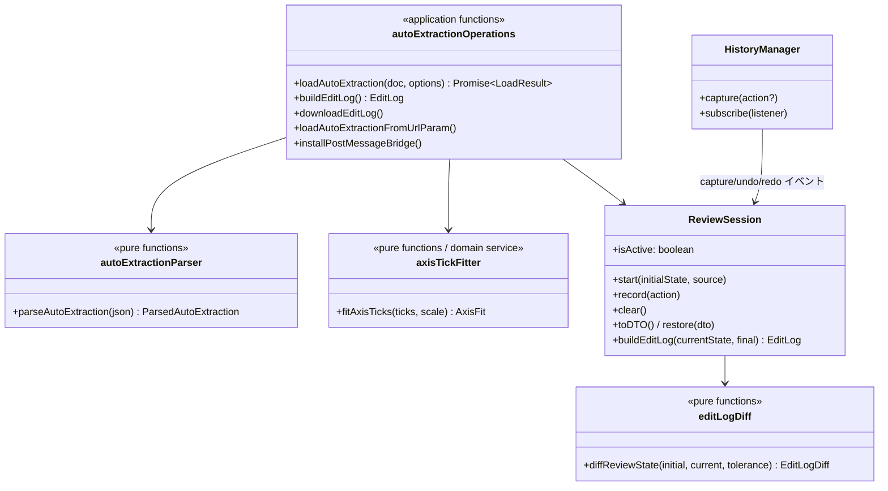

# 実装設計: 自動抽出結果のレビュー(取り込み形式・編集ログ)

> **2026-10 の移植について**: この文書は develop 系(シングルトン構成)で書いた。starrydata3-integration 系へ移植した版では、
> `applicationServiceInstances.ts` のシングルトンは無く、`ReviewSession` / `ConfidenceReview` / `ReviewView` は
> `DigitizerContext` のメンバー(`ctx.reviewSession` など)、操作はすべて `ctx` を第 1 引数に取る
> (`loadAutoExtraction(ctx, doc)`、`buildEditLog(ctx)` …)。ライブラリの入口は `library-build/entry.ts` ではなく
> `src/core-main.ts`(状態と操作)と `src/vue-main.ts`(パネル)。`HistoryManager` の購読は `HistoryChange` を受け取り、
> 操作名は `change.action` に入る。URL パラメータと postMessage は `autoExtractionBridge.ts`。
> サーバー側の自動機能(Auto-place / Server Extraction)は [auto-service.md](auto-service.md)。

依頼元: real-chart-bench(論文図の自動抽出ベンチマーク)。依頼文は 6 機能(取り込み、信頼度表示、系列編集、編集ログ、
画素座標つき書き出し、差分表示)で、優先は 1 → 4 → 3 → 2 → 5 → 6。**本設計で実装するのは 1(自動抽出結果の取り込み)と
4(編集ログ)**。2/3/5/6 は本設計のデータ構造の上に後から載せられるよう、拡張点だけ決めておく(末尾「後続機能への拡張点」)。

**追記(第 2 段階)**: 続けて 3 → 2 → 5 を実装する。設計は末尾の「3. 系列の編集」「2. 信頼度のレビュー」「5. 図の情報の書き出し」。
6(差分の重ね表示)は第 3 段階として末尾「6. 読み込み直後との比較表示」。

## 既存機能との重なり(調査結果)

| 既存機能 | 場所 | 重なり | 方針 |
|---|---|---|---|
| プロジェクト保存/読み込み(ZIP: `project.json` + 画像) | `ProjectService`, `projectFileOperations.ts` | 「状態を外から入れる」点で重なる | `project.json` は内部状態のダンプ(点 id、`visiblePointIds`、`pointMode`、拡大率…)で、外部の抽出器が書く形式には向かない。**取り込み形式は別に定める**が、取り込み後の状態は既存の `AxisSet` / `Dataset` そのものなので、保存/読み込み・undo はそのまま効く。レビュー中の状態(初期状態と操作ログ)は `ProjectDTO` に任意フィールド `reviewSession` として足し、途中保存→再開しても編集ログが続くようにする |
| JSON 書き出し | なし(書き出しはクリップボードへの CSV と ZIP のみ) | — | 編集ログの `final` に「取り込み形式と同じスキーマの最終状態(画素座標+値)」を入れる。これが機能 5 の土台になる |
| 軸 OCR(`AxisOcrReader` + `axisOcrMatcher`) | `AxisSetSettings.vue` | 軸の値を自動で入れる点で重なる | 取り込みで `axes` があれば軸校正済みの状態で始まるので OCR は不要。`axes: null` なら従来どおり人が x1/x2/y1/y2 をクリックし、OCR も使える。コードの共有はない |
| 自動検出(`Extractor` の Symbol/Line Extract) | `ExtractorSettings.vue` → `datasetRepository.setPoints()` | 点を自動で置く点で重なる | 取り込んだ系列も同じ `Dataset` なので、取り込んだ系列の上で既存の自動検出を走らせることもできる(その場合、元の点は「削除」、新しい点は「追加」として編集ログに数えられる) |
| Undo/Redo(`HistoryManager`) | `capture()` を各編集操作の直前に呼ぶ | 「編集操作の発生点」を既に網羅している | 編集ログのイベント記録は `capture(action)` にラベルを足してフックする(各画面にログ処理を散らさない)。取り込み直後は新しい画像を開いたときと同じく履歴を消す |
| 軸の値⇄画素の変換(`AxisSetCalculator`) | `calculateXYValues` / `calculatePixelCoordinates` | 値で渡された点を画素に置く・最終状態を値で出す | そのまま使う。目盛 3 本以上の最小二乗校正は、その結果を既存の 4 点(x1/x2/y1/y2)へ落とし込むので、計算器は変えない |

## 1. 取り込み形式(`starry-digitizer/auto-extraction` v1)

依頼の案を基本に、曖昧な所だけ決めた。確定版の説明は `/var/tmp/starry-digitizer-auto-extraction-schema-v1.md` に置く(real-chart-bench 向け)。

```jsonc
{
  "format": "starry-digitizer/auto-extraction", // 任意。あれば一致を検査
  "version": 1,                                  // 必須。1 のみ
  "image": "fig.png" | { "url": "...", "width": 800, "height": 600 } | null, // 任意
  "axes": {                                      // 任意。null/省略 = 軸は人が校正する
    "x": { "scale": "linear" | "log", "ticks": [{ "px": 120.0, "value": 300 }, ...] },
    "y": { "scale": "linear" | "log", "ticks": [{ "px": 480.5, "value": 0.1 }, ...] }
  },
  "series": [{
    "label": "x=0.1",                            // 任意。なければ "series 1" ...
    "points_px":    [[x, y], ...] | null,        // 画像の画素座標
    "points_value": [[x, y], ...] | null,        // 印字どおりの値
    "scores":       [0.93, ...] | null           // 点ごとの信頼度(任意)
  }],
  "source": { "extractor": "markernet-v2", "run": "..." } // 任意・自由形式。編集ログにそのまま写す
}
```

決めたこと:

- **画素座標の約束**: 元画像の画素単位、原点は左上の画素の左上の角、x は右、y は下が正。画素 (i, j) の中心は (i + 0.5, j + 0.5)。
  starry-digitizer がクリック位置を記録する座標系と同じ。numpy の添字(中心 = 整数)で持っている書き出し側は 0.5 を足す。
- **目盛の `px`**: x 軸の目盛は x 画素座標、y 軸の目盛は y 画素座標(1 次元)。軸は画像の縦横に平行と仮定する(傾き補正は人が後で使える)。
- **目盛 2 本以上**: 値(log 軸は log10 値)と画素の間を最小二乗で直線に当てはめ、目盛ごとの残差(当てはめた画素 − 与えた画素)、
  RMS、最大値を返す。当てはめた直線から、最小値と最大値の目盛の位置に既存の x1/x2(y1/y2)を置く。残差が大きい(既定 2px 超)ときは警告。
  ゼロ割れ・同一値・log 軸で値 ≤ 0 はエラー。
- **点の座標の優先順**: `points_px` があればそれで置く。`points_px` が null で `points_value` だけなら、`axes` で画素へ変換して置く
  (`axes` が無ければエラー)。両方あるときは `points_px` で置き、`points_value` は取り込み時の値として保持するだけ(照合はしない)。
  `points_px` / `points_value` / `scores` は、あれば同じ長さでなければならない。
- **画像の範囲外の点**: 取り込むが警告に数える(凡例・目盛を拾った誤検出は人が消せばよい)。数値でない座標はエラー。
- **画像**: 文字列は URL(データ URL 可)。オブジェクトは `url` と、照合用の `width` / `height`。`null`・省略なら今の画像のまま
  (ライブラリ API で画像を別に渡す場合もこれ)。`width` / `height` が実画像と違えば警告。URL パラメータから読んだ場合、
  相対 URL は JSON の URL を基準に解決する。画像は fetch してデータ URL にしてから読み込む(別オリジンの画像で canvas が汚れて
  自動検出が使えなくなるのを防ぐ。相手側に CORS が必要)。
- **未知のフィールドは無視**(将来の追加で古い starry-digitizer が壊れないように)。`version` が 1 以外はエラー。

取り込みの結果、既存の状態はすべて置き換える(軸セット 1 つ、系列ごとに `Dataset` 1 つ、「View All」表示、履歴は消去)。

### 点の出自の記録

`Point` 型に任意フィールドを 2 つ足す。

```ts
export type Point = {
  id: number
  xPx: number
  yPx: number
  origin?: { series: number; index: number } // 取り込んだ点だけが持つ。series/index は取り込み文書での添字
  score?: number                              // 取り込み時の信頼度(機能 2 で使う)
}
```

点の移動(`moveActivePoint`)は同じオブジェクトを書き換え、undo のスナップショットとプロジェクト保存は `points` をそのまま
JSON にするので、`origin` はどの経路でも保たれる。人が足した点には `origin` が無い。**これにより編集ログは「操作を数える」の
ではなく「初期状態と現在の状態の差」から決まる**(下記)。

### 渡し方(入口)

1. **ライブラリ API**(`library-build/entry.ts` から export)
   - `parseAutoExtraction(json: unknown): ParsedAutoExtraction`(検査と正規化だけ。状態は変えない。エラーは例外)
   - `loadAutoExtraction(doc, options?: { image?: string; baseUrl?: string }): Promise<AutoExtractionLoadResult>`
     (`AutoExtractionLoadResult` = 系列数・点数・軸校正の残差・警告)
   - `buildEditLog(): EditLog | null`、`downloadEditLog(filename?)`
2. **URL パラメータ**: `?extraction=<JSON の URL>`(http/https のみ)。起動時に fetch して取り込む。
3. **postMessage**: 起動時に `window.opener` / `window.parent` へ `{ type: 'starry-digitizer:ready' }` を送る(データを含まないので
   targetOrigin は `*`)。受け付けるのは **`window.opener` か `window.parent` から来たメッセージだけ**(任意のページから状態を
   入れ替えられないように)。
   - `{ type: 'starry-digitizer:load-auto-extraction', document, image? }` → 取り込んで `{ type: 'starry-digitizer:load-result', ok, result | error }` を返す
   - `{ type: 'starry-digitizer:get-edit-log' }` → `{ type: 'starry-digitizer:edit-log', editLog }` を返す(返信先は送り主のオリジンに限る)
4. **アプリのメニュー**: File → 「Import Auto-Extraction (JSON)…」「Export Edit Log (JSON)」。

## 4. 編集ログ(`starry-digitizer/edit-log` v1)

### 考え方: 差分が主、操作の記録は従

- 既存の編集経路は一律ではない(削除モードのクリック・自動検出・軸の値の入力欄は `capture()` を呼ばない)。操作を数えるだけだと
  取りこぼし、undo で戻した操作の扱いも曖昧になる。そこで **修正コストの数値(`summary`)は、取り込み直後の状態と書き出し時の
  状態の差から計算する**。どの UI 経路で直しても、undo しても、途中で保存・再読み込みしても同じ答えになる。
- 加えて、時刻つきの操作の記録(`events`)も残す。`HistoryManager.capture(action)` にラベルを渡し、`HistoryManager` の購読者として
  `ReviewSession` が記録する。undo/redo もイベントとして残る。時間や手数を見たい分析用で、`summary` には使わない。
  ついでに、削除モードのクリックと自動検出の実行にも `capture()` を足す(undo できなかった操作が undo できるようになる)。

### 差分の定義

取り込み時に `ReviewSession` が初期状態(系列ごとの点の画素座標、軸校正の 4 点・値・log 指定)を保持する。書き出し時の状態と比べる。

- 点(`origin` で同一性を判定)
  - **deleted**: 初期にあって、どの系列にも残っていない
  - **moved**: 残っていて、移動量が `moveTolerancePx`(既定 0.5px)を超える。移動量(px)の一覧も出す
  - **kept**: 残っていて動いていない
  - **added**: `origin` を持たない点(人が足した点、補間で確定した点、自動検出で置き直した点)
  - **reassigned**: 残っている点のうち、元の系列の「主な行き先」(その系列の点を最も多く含む `Dataset`)以外にある点
- 系列
  - **split**: 元の系列 s の点が k 個の `Dataset` に分かれていれば k − 1 を数える
  - **merged**: 1 つの `Dataset` に k 本の元系列の点が入っていれば k − 1 を数える
  - **added**: 点を持ち、`origin` つきの点を 1 つも持たない `Dataset`
  - **removed**: 初期に点があり、点が 1 つも残っていない元系列
  - **renamed**: 主な行き先の名前が元の `label` と違う
- 軸
  - 取り込み時に校正済みなら、x1/x2/y1/y2 のうち位置が `moveTolerancePx` を超えて動いた・値が変わったものの数、log 指定の変更の数
  - 取り込み時に未校正なら `initially_calibrated: false` とし、書き出し時に校正済みかどうかだけ出す(人がゼロから校正した、の意)

### 出力

```jsonc
{
  "format": "starry-digitizer/edit-log",
  "version": 1,
  "source": { ... },                      // 取り込み文書の source をそのまま
  "imported_at": "2026-10-09T01:23:45.000Z",
  "exported_at": "2026-10-09T01:30:00.000Z",
  "elapsed_ms": 375000,
  "move_tolerance_px": 0.5,
  "summary": {
    "points":  { "initial": 120, "final": 118, "kept": 100, "moved": 10, "deleted": 10, "added": 8, "reassigned": 3 },
    "series":  { "initial": 4, "final": 3, "split": 0, "merged": 1, "added": 0, "removed": 0, "renamed": 1 },
    "axes":    { "initially_calibrated": true, "finally_calibrated": true, "reference_points_changed": 1, "scale_changed": 0 },
    "events":  { "total": 42, "undo": 2, "redo": 0 }
  },
  "details": {
    "moved":   [{ "series": 0, "index": 3, "dx": 1.0, "dy": -2.0, "distance": 2.24 }],
    "deleted": [{ "series": 1, "index": 7, "px": [301.5, 220.0], "score": 0.31 }],
    "added":   [{ "dataset": "x=0.1", "px": [140.0, 300.5] }],
    "series_mapping": [{ "series": 0, "label": "x=0.1", "destinations": [{ "dataset": "x=0.1", "points": 30 }] }]
  },
  "events": [{ "t_ms": 1200, "action": "point.add" }, { "t_ms": 3400, "action": "undo" }],
  "final": { /* 取り込み形式 v1 と同じスキーマの最終状態(points_px と、校正済みなら points_value) */ }
}
```

`final` は取り込み形式と同じなので、そのまま読み込み直せる。`final.axes` は x1/x2/y1/y2 の 4 点を目盛 2 本ずつとして出す。
`final.series[].scores` は元の点の score を引き継ぐ。人が足した点に仮の値(1 など)を入れると意味の違う値が混ざるので、
**score を持たない点が 1 つでもある系列では `scores` を `null` にする**。点ごとの出自は `final.series[].origins`
(`[[series, index] | null, ...]`)として出す(取り込み時は無視される拡張フィールド)。

## 構成



- 純粋関数(`autoExtractionParser.ts`、`editLogDiff.ts` は `src/application/utils/`、`axisTickFitter.ts` は `src/domain/services/`)は
  DOM に触れず Jest で網羅する。
- `ReviewSession`(`src/application/services/reviewSession/`)は状態だけを持つ。`applicationServiceInstances.ts` で `HistoryManager` と
  同じく直接生成し、`historyManager.subscribe()` で操作を受ける。
- `autoExtractionOperations.ts` は `projectFileOperations.ts` と同じく、シングルトンのリポジトリ・`canvasHandler` を使って状態を
  組み立てる層。アプリのメニュー、URL パラメータ、postMessage、ライブラリ API がすべてここを通る。
- 画面: `StarryDigitizer.vue` の左サイドバーに `ReviewSessionPanel.vue` を足す(レビュー中だけ表示)。出自(extractor/run)、
  軸校正の残差、差分の要約(moved/deleted/added…)を常に表示し、「Export Edit Log」ボタンを置く。ライブラリに埋め込んだ場合も出る。
- プロジェクト保存: `ProjectDTO.reviewSession?`(初期状態・source・取り込み時刻・イベント)。読み込み時にあれば復元、無ければレビュー終了。
- 新しい画像を開いたとき(`ImageSettings`)はレビューを終了する(履歴を消すのと同じ理由)。

## 対象外

- 取り込み時の `points_value` と `points_px` の照合
- 軸が画像の縦横に平行でない場合の目盛の 2 次元指定(v1 は 1 次元の `px` のみ)
- 複数の軸セット(取り込みは軸セット 1 つ)

---

# 第 2 段階: 系列の編集・信頼度のレビュー・図の情報の書き出し

第 1 段階(取り込み・編集ログ)の上に載せる。共通の約束:

- どの操作も直前に `historyManager.capture('<操作名>')` を呼ぶ。undo でき、編集ログの `events` にも出る。
- 点を別の系列へ移すときは `origin` と `score` ごと移す。これだけで編集ログの split / merged / reassigned が差分から正しく出る
  (編集ログの計算は変えない)。
- 操作はレビュー中でなくても使える(手で取った点の整理にも役立つ)。

## 3. 系列の編集

依頼: LLM の「1 本の系列を数本に切る」と、検出器の「同じマーカーで重複点を出す」「別系列が混ざる」を直接直す。

### 既存との関係

- 点の選択は既にある: EDIT モード(`e`)でのドラッグ矩形選択(`activatePointsInRectangleArea`)と、Ctrl/⌘+クリックの追加・解除。
  **選択の仕組みはそのまま使い**、足すのは次の 2 つだけ:
  - **投げ縄選択**: 斜めに走る系列が交差していると矩形では分けられないため。右サイドバーで「Box / Lasso」を切り替える。
    投げ縄の軌跡は矩形と同じ `tempMaskCanvas` に描き、離したときに多角形の内側の点を選ぶ(偶奇判定)。
  - **追加選択**: Ctrl/⌘ を押しながらドラッグを終えると、今の選択に足す(矩形・投げ縄の両方)。
- 系列(`Dataset`)の追加・削除・名前変更は `DatasetManager` に既にある。統合・移動・分割は無いので足す。

### 操作(ドメイン)

| 操作 | 置き場所 | 内容 | 操作名 |
|---|---|---|---|
| 系列の統合 | `DatasetRepository.mergeDatasets(sourceId, targetId)` | source の全点を target の末尾へ移し、source を消す | `series.merge` |
| 選択点を別系列へ移す | `DatasetRepository.movePoints(fromId, pointIds, toId)` | | `points.move-to-series` |
| 選択点を新しい系列に分ける | `DatasetRepository.splitPointsToNewDataset(fromId, pointIds)` | 新系列名は `<元の名前> (split)`、軸セットは元と同じ | `points.split-to-new-series` |
| 近接重複点の統合 | `Dataset.mergeDuplicatePoints(maxDistancePx)` | 下記 | `points.merge-duplicates` |

点を移すと移し先で id を振り直す(id は系列内でしか一意でないため)。`origin` / `score` は保つ。移した点は移し先で表示・選択状態にする。

### 近接重複点の統合

- 対象は今の系列(Active dataset)だけ。「同じ系列で数 px 以内」(依頼どおり)。既定 3px、パネルで変えられる。
- **単連結(つながったものを全部まとめる)にはしない**。線グラフや密な系列では点が数 px 間隔で並ぶので、鎖のように系列全体が
  1 点に潰れてしまう。代わりに貪欲法: score の高い順(score が無ければ id 順)に「代表点」を選び、まだどこにも属していない点のうち
  代表点から `maxDistancePx` 以内のものをその代表点の組に入れる。
- 組ごとに代表点を 1 つ残し、**位置は組の重心**に動かす(大きい模様付きマーカーでの重複は、どれもマーカー中心からずれているため)。
  代表点の `origin` / `score` を残すので、編集ログでは「代表点の移動 1 + 他の点の削除」と数えられる。
- 純粋関数 `findDuplicateClusters(points, maxDistancePx)` を `src/domain/services/duplicatePointFinder.ts` に置いて Jest で検証する。

### 画面

右サイドバーに「Series Editing」パネル(`SeriesEditingPanel.vue`)を足す。View All モード中は無効(既存どおり編集不可のため)。

- 選択数の表示、`Move to ▾`(他の系列の一覧)、`New series`
- 選択方法 `Box / Lasso`
- `Merge "<今の系列>" into ▾`
- 重複点: 距離(px)と `Merge duplicates` ボタン。統合した点の数を表示する

## 2. 信頼度のレビュー

依頼: score の低い点を色で目立たせる / 「次の怪しい点へ」で順に見る / しきい値のスライダーで低スコア点をまとめて消す・戻す。

### しきい値と表示

- 状態は `ConfidenceReview`(`src/application/services/confidenceReview/`、reactive なシングルトン)に置く: しきい値(既定 0.5)と、
  巡回中の点。表示上の状態なので undo・プロジェクト保存の対象にはしない。
- `score < しきい値` の点を「怪しい点」として **濃いピンク**で描く(赤は選択中、青は通常、紫は補間のアンカー、View All の系列色と
  ぶつからない色)。score を持たない点(人が足した点など)は対象外。
- `Dataset.scaledPoints()` が `score` を落としていたので、`{ ...point, xPx, yPx }` に直して描画側へ渡す。
- 拡大鏡(`MagnifierPoints.vue`)の中の点も同じ規則で色を付ける(第 3 段階で追加)。色は `STYLE.LOW_CONFIDENCE_POINT_COLOR` に共通化。

### 順に見る

- 怪しい点を **score の低い順**(同点は系列順・id 順)に並べ、`Next` / `Prev`(キーボード `n` / `Shift+n`)で巡回する。
  全系列が対象で、移るときにその系列を Active にし、その点を選択し、拡大鏡のカーソルをその点に置き、キャンバスをその点までスクロールする。
  選択されるので、そのまま `Delete` で消す・矢印キーで動かす、が既存の操作でできる。
- 並べ替えは純粋関数 `listLowConfidencePoints(datasets, threshold)`(`src/application/utils/confidenceReview.ts`)。

### まとめて消す・戻す

- 「消す」は本当に系列から取り除く(書き出し・CSV・自動検出・補間など既存の全経路が何もしなくても正しくなる)。ただし捨てずに
  `Dataset.scoreRemovedPoints` に退避し、「戻す」で元の系列に戻す。
  - `Remove below threshold (N)`: 全系列で `score < しきい値` の点を退避する(`points.remove-below-score`)
  - `Restore removed (M)`: 退避した点を全部戻す(`points.restore-score-removed`)。しきい値を上げすぎた後の取り消しにも使える
- 退避先は `DatasetDTO.scoreRemovedPoints?` として undo のスナップショットとプロジェクト保存に含める。
  `nextPointId` は退避中の点の id も数える(戻したとき id がぶつからないように)。
- 編集ログ: 退避中の点は「削除」に数える(最終結果に入らないため)。区別できるよう `summary.points.deleted_by_threshold` と
  `details.deleted[].by_threshold` を足し、書き出し時点のしきい値を `score_threshold` に出す(いずれも追加のみ。v1 のまま)。

### 画面

右サイドバーに「Confidence Review」パネル(`ConfidenceReviewPanel.vue`)。score を持つ点が 1 つも無いときは出さない。
しきい値のスライダー、怪しい点の数、`Prev` / `Next`、`Remove below threshold`、`Restore removed`。

## 5. 図の情報の書き出し

依頼: JSON の書き出しで、各点の画素座標・軸の目盛(画素 + 値)・描画領域の矩形・凡例の矩形(任意で人が囲う)・系列ごとの
マーカーの形・塗り・大きさ(任意)を出す。人が直した結果をそのまま検出器の学習データにする。

### 置き場所

- **描画領域・凡例の矩形は `AxisSet` に持たせる**(`plotArea?`、`legendArea?`、元画像の画素の `{xPx, yPx, widthPx, heightPx}`)。
  1 枚の図に複数のパネルがあれば、軸セットごとに描画領域と凡例があるので。`AxisSetDTO` にも足し、undo とプロジェクト保存に乗せる
  (DTO 変換は `ProjectService` と `HistoryManager` に重複してあるので両方直す)。
- **マーカーは `Dataset.marker?`**: `{ shape, fill, sizePx }`。
  - `shape`: `circle` `square` `diamond` `triangle-up` `triangle-down` `triangle-left` `triangle-right` `pentagon` `hexagon` `star`
    `cross`(×) `plus`(+) `other`
  - `fill`: `filled` `open` `half` `other`
  - `sizePx`: マーカーの外接幅(元画像の画素)
  - どれも任意。決めた項目だけ出す。

### 囲う操作

- 「Figure Annotations」パネル(`FigureAnnotationPanel.vue`、右サイドバー)の `Draw plot area` / `Draw legend area` を押すと、
  次のドラッグ 1 回がその矩形になる(`canvasHandler.annotationTarget`)。ドラッグ中の仮表示は矩形選択と同じ `tempMaskCanvas`。
  確定した矩形は点線の枠(`CanvasAnnotations.vue`)で常に表示し、パネルで消せる。
  ドラッグ直後に発火する click で点が追加されないよう、確定後の最初の click は捨てる。
- マーカーは同じパネルで、今の系列について形・塗り・大きさを選ぶ。

### 形式

取り込み形式に任意フィールドを足す(**v1 のまま**。v1 は未知フィールドを無視する約束なので、新しい文書を古い starry-digitizer に
渡しても読めるし、古い文書はそのまま有効)。版は上げない。

```jsonc
{
  "plot_area":   { "x": 150, "y": 120, "width": 900, "height": 730 } | null,   // 元画像の画素、左上の角が原点
  "legend_area": { "x": 700, "y": 140, "width": 200, "height": 120 } | null,
  "series": [{ "...": "...", "marker": { "shape": "circle", "fill": "open", "size_px": 12 } | null }]
}
```

- 取り込み時に読み、`AxisSet` / `Dataset` に入れる(検出器が出した矩形・マーカーを人が直す、もできる)。
- **書き出し**: File → `Export Data (JSON)` を足す。中身は編集ログの `final` と同じ `buildFinalDocument()` で、レビュー中でなくても
  使える(手で取った図も学習データにできる)。`final` にも同じ項目が入る。

---

---

# 第 3 段階: 読み込み直後との比較表示(依頼の 6)

依頼: 読み込んだ初期状態と現在の状態を切り替え・差分表示できる(何を直したかが見える)。

## 方針

- **差分の中身は編集ログと同じ計算(`diffReviewState`)を使う**。画面に見える「直したこと」と、書き出す修正コストが食い違わないように。
  描くのに足りない情報だけ `details` に足す: `reassigned`(別の系列へ移った点。今は件数しか無い)。追加のみなので編集ログ v1 のまま。
- 描画用の形への変換は純粋関数 `buildReviewDiffOverlay(initial, current, tolerance)`(`src/application/utils/reviewDiffOverlay.ts`)。
  移動は「初期位置 → 今の位置」、削除は初期位置、追加は今の位置、軸の基準点の移動は「初期 → 今」。座標は元画像の画素。
- 表示は SVG 1 枚(`CanvasReviewDiff.vue`)をキャンバスに重ね、`pointer-events: none` にする。クリック・ドラッグ・選択など既存の
  操作の邪魔をしない。全系列の変化を出す(今の系列だけでなく)。
- 表示状態は `ReviewView`(`src/application/services/reviewView/`、reactive なシングルトン)。表示だけの状態なので undo・保存の対象外。

## 2 つの表示

1. **変化の重ね表示**(切り替え式、レビュー欄のチェックボックス「Show changes」):
   - 移動: 初期位置に灰色の中抜きの丸、今の位置まで点線
   - 削除: 初期位置に赤い ×(しきい値で外した点は濃いピンクの ×)
   - 追加: 今の点に緑の輪
   - 別系列へ移った点: 今の点に橙の輪
   - 軸の基準点の移動: 初期位置に中抜きの四角、今の位置まで点線
2. **初期状態の表示**(押している間だけ、レビュー欄のボタン「Hold to show imported」またはキー `I` を押し続ける):
   今の点を隠し、読み込み直後の点を系列ごとの色で描く。離すと戻る。
   - 切り替え式にしなかった理由: 初期状態を出したまま編集できると、見えない今の点を操作することになる。押している間だけなら、
     その間に編集は起きない(キーは CanvasMain の編集キーと重ならない `i`)。見比べ(フリッカー比較)にも向く。
   - 窓のフォーカスが外れたら(`blur`)戻す。キーを離したイベントを取りこぼしても表示が残らないように。

## 既知の課題(別課題、今回は直さない)

- **プロジェクト読み込み後、拡大鏡の画像が更新されない可能性がある(未確認)**。`projectFileOperations.ts` の `loadProjectFromFile()` が、
  シングルトンの `canvasHandler` / リポジトリを reactive proxy を通さずに書き換えている(`setUploadImageUrl()` など)ため、
  `MagnifierImage.vue` などが再描画されないはず。本機能の取り込み(`autoExtractionOperations.ts`)で同じ症状が出て、`reactive()` の
  proxy 経由で書き換えるように直した(第 1 段階)。プロジェクト読み込み側は未修正・未再現なので、まず再現を確かめること。

